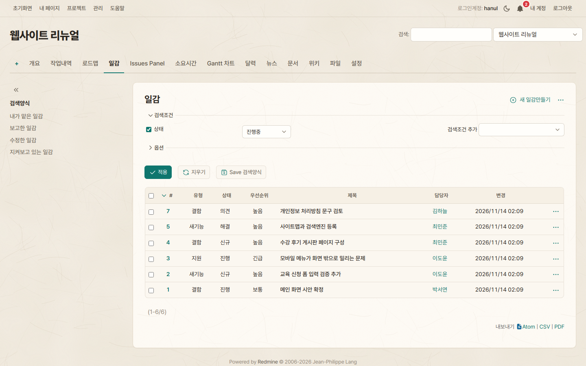
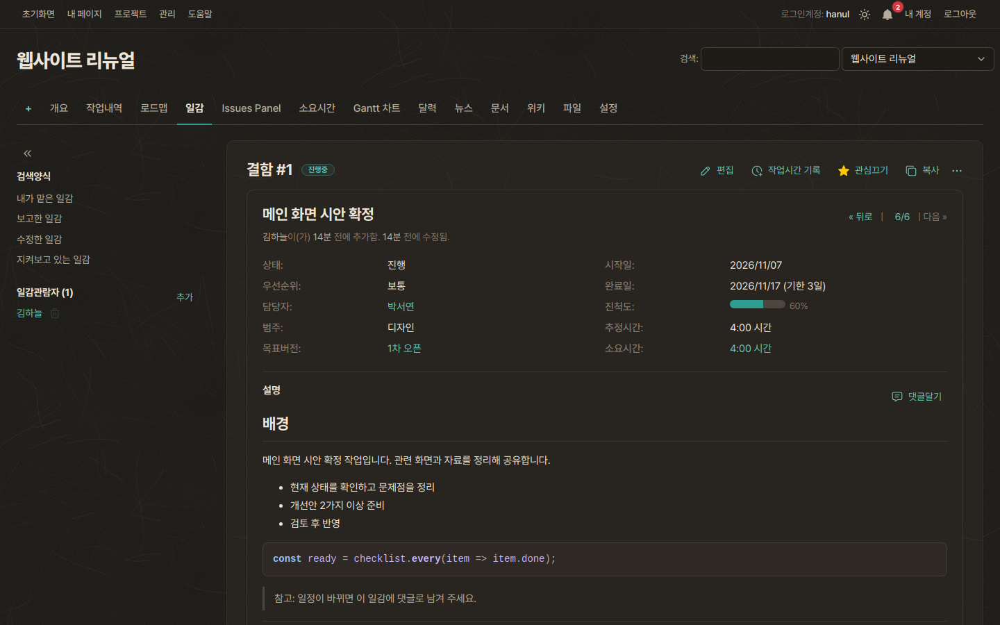
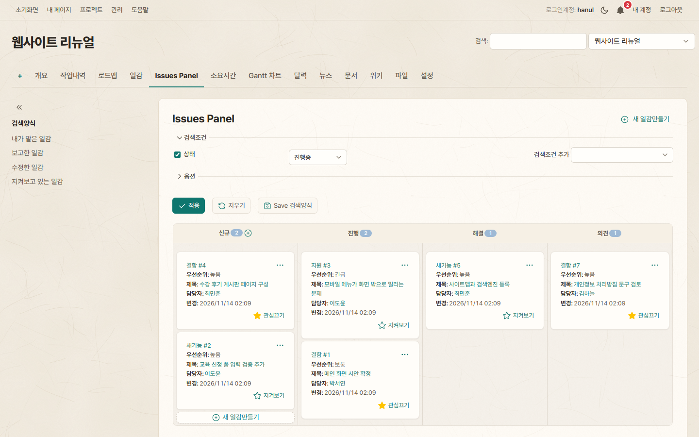
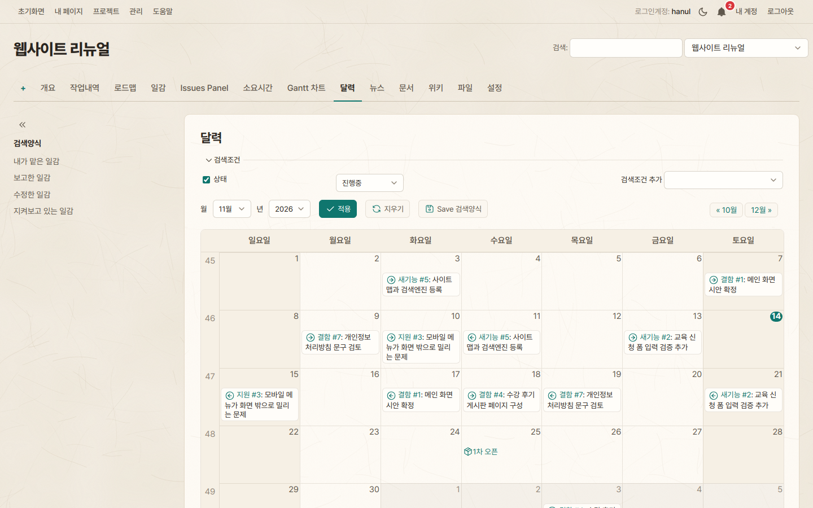
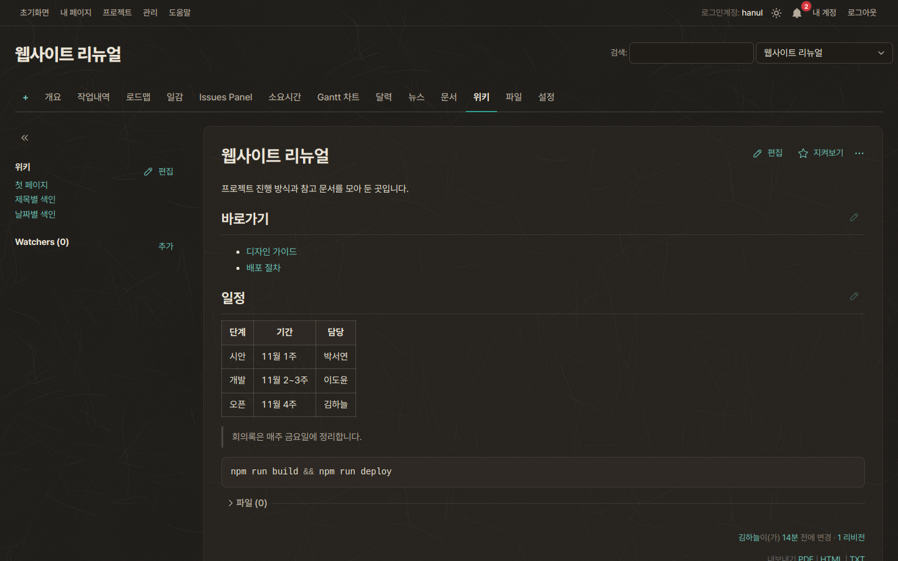
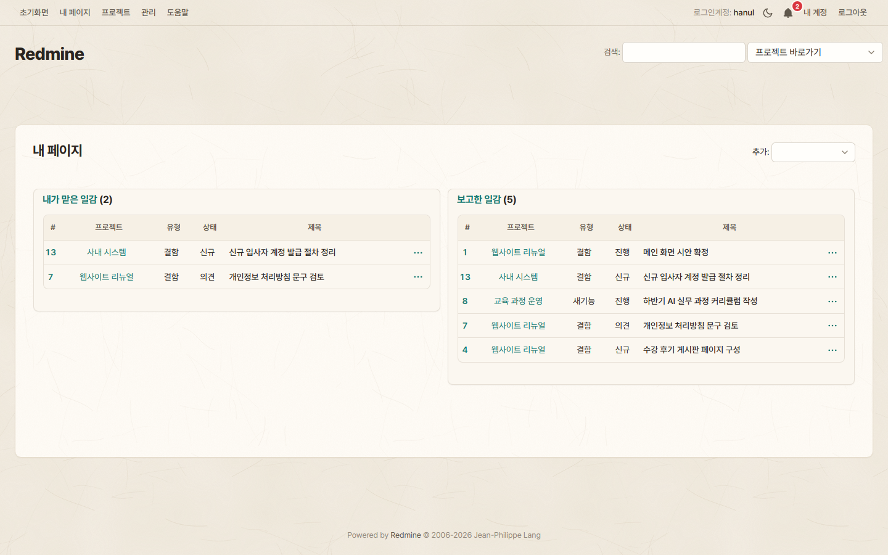
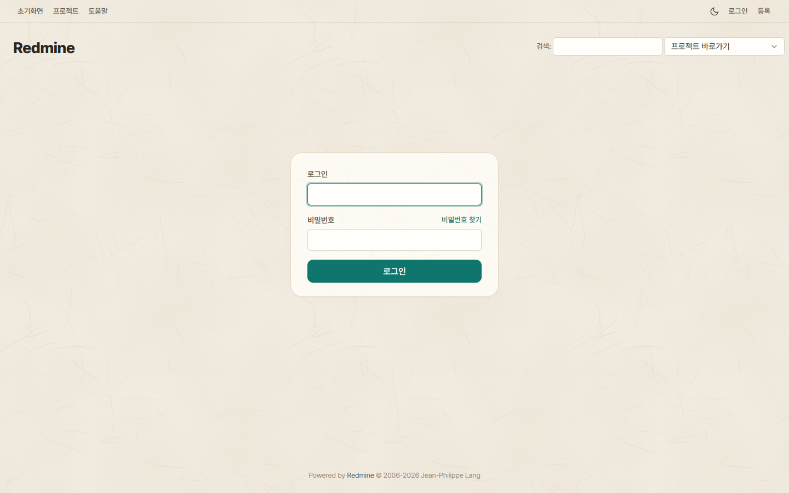
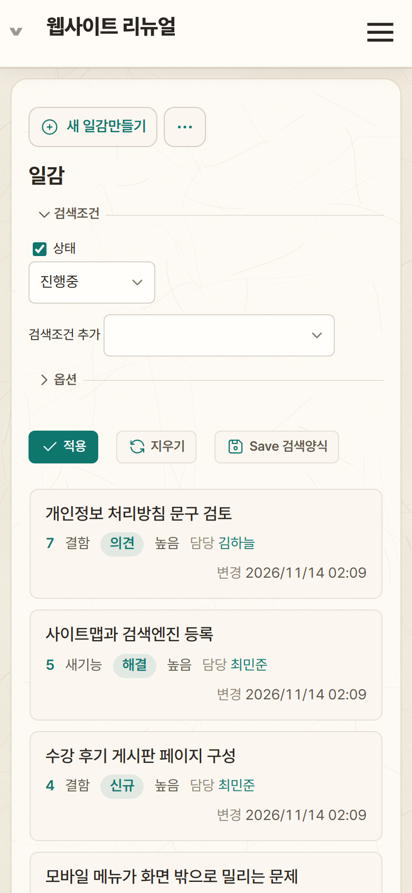
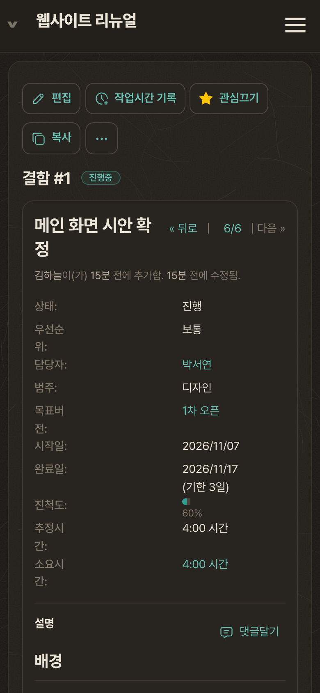
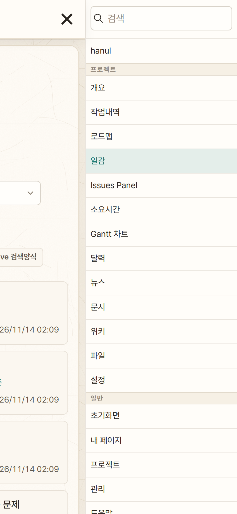

# Hanji Redmine Theme

[English](README.md) | **한국어**

[Redmine](https://www.redmine.org/) 6용 테마입니다. 이름은 한지(韓紙)에서 따왔습니다.
닥 섬유 결과 고르지 않은 밀도가 은은하게 보이는 아이보리 한지 바탕에 따뜻한 흰색 카드와 얇은 베이지 선, 먹색 글자를 쓰고, 포인트 색은 진한 Teal 하나만 씁니다.
종이 질감 외에는 그라데이션이나 투명 효과 같은 장식 없이 글이 잘 읽히는 데 맞췄습니다. 밝은 화면과 어두운 화면을 모두 지원합니다.

## 스크린샷

**일감 목록 — 라이트 모드**



| **일감 보기 — 다크 모드** | **칸반(Issues Panel)** |
|---|---|
|  |  |
| **달력** | **위키 — 다크 모드** |
|  |  |
| **내 페이지** | **로그인** |
|  |  |
| **휴대폰 — 일감 목록, 일감 보기, 메뉴** | |
|    | |

스크린샷의 프로젝트, 이름, 일감은 모두 가상의 내용입니다.

## 특징

- **한지 질감.** 바탕에는 닥 섬유와 고르지 않은 종이 밀도를, 본문 카드에는 그보다 옅은 섬유 결을 넣었습니다. 이미지 파일 없이 CSS 안의 SVG로 그립니다.
- **종이 같은 화면.** 바탕 위에 본문 카드 하나를 두고, 사이드바는 테두리 없이 왼쪽에 둡니다.
- **밑줄 탭.** 프로젝트 메뉴는 한 줄의 탭이고, 선택된 메뉴에만 Teal 밑줄이 붙습니다.
- **포인트 색 하나.** 주 버튼, 선택 표시, 진행 막대, 링크를 Teal(`#0F766E`) 하나로 통일했습니다.
- **라이트와 다크.** 처음에는 운영체제 설정을 따르고, 오른쪽 위의 해/달 버튼으로 바꿀 수 있습니다. 선택은 브라우저에 저장됩니다. 다크 모드는 따뜻한 숯색입니다.
- **휴대폰.** 일감 목록은 카드로 바뀌고, 입력창은 크게 표시합니다. 입력창 글자는 16px이라 iPhone에서 화면이 확대되지 않습니다.
- **플러그인.** Issues Panel(칸반), Checklists(redmineup), 웹 알림 벨의 색을 테마에 맞췄습니다.
- **가벼움.** 외부 글꼴이나 이미지를 불러오지 않습니다. 스타일시트 하나와 해/달 버튼을 넣는 짧은 스크립트 하나가 전부입니다. 인쇄하면 흰 바탕으로 나옵니다.

## 설치

Redmine 폴더에서 `themes/hanji` 라는 이름으로 내려받습니다.

```bash
cd /path/to/redmine
git clone https://github.com/IrumAcademy/Redmine-Hanji-Theme.git themes/hanji
```

1. Redmine을 재시작합니다. Redmine 6은 시작할 때 테마 파일을 다시 빌드합니다.
2. **관리 → 설정 → 표시방식 → 테마**에서 **Hanji**를 고르고 저장합니다.

업데이트는 `git -C themes/hanji pull`을 실행한 뒤 Redmine을 재시작하면 됩니다.

### Docker (공식 `redmine` 이미지)

```yaml
services:
  redmine:
    image: redmine:6.0
    volumes:
      - ./themes/hanji:/usr/src/redmine/themes/hanji:ro
```

`docker compose up -d`로 컨테이너를 다시 만든 뒤 위와 같이 테마를 고릅니다.
테마 파일을 고친 뒤에는 `docker compose restart redmine`으로 재시작해야 적용됩니다.

## 색 바꾸기

`stylesheets/application.css` 위쪽의 토큰 두 묶음에서 바꿉니다. `:root`는 라이트, `html.hanji-dark`는 다크입니다.

| 토큰 | 용도 |
|---|---|
| `--hj-accent`, `--hj-accent-hover` | 주 버튼, 선택된 탭 밑줄, 진행 막대 |
| `--hj-accent-text` | 링크와 아이콘 |
| `--hj-accent-soft`, `--hj-accent-softer`, `--hj-accent-ring` | 선택 배경, 행 hover, 입력창 포커스 테두리 |
| `--hj-bg`, `--hj-card`, `--hj-card-border` | 바탕, 본문 카드, 카드 테두리 |

## 호환

- Redmine 6.0.11에서 다음 화면을 확인했습니다: 일감 목록·보기·새로 만들기, 칸반, 달력, Gantt, 로드맵, 위키, 프로젝트, 내 페이지, 관리 설정, 로그인. 데스크톱과 휴대폰(390px), 라이트와 다크 모드에서 모두 봤습니다.
- 최신 Chrome, Edge, Safari, Firefox.
- 휴대폰 일감 카드의 "담당", "변경" 머리말은 한국어 화면에서만 붙습니다.
- 다른 플러그인 화면에서는 기본 색이 남는 곳이 있을 수 있습니다. 발견하면 이슈로 알려 주세요.

## 라이선스

[MIT](LICENSE) © 2026 IrumAcademy
