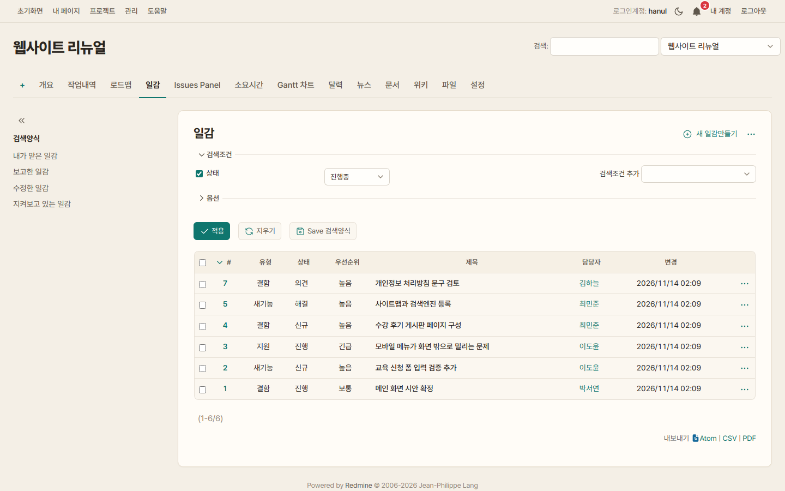
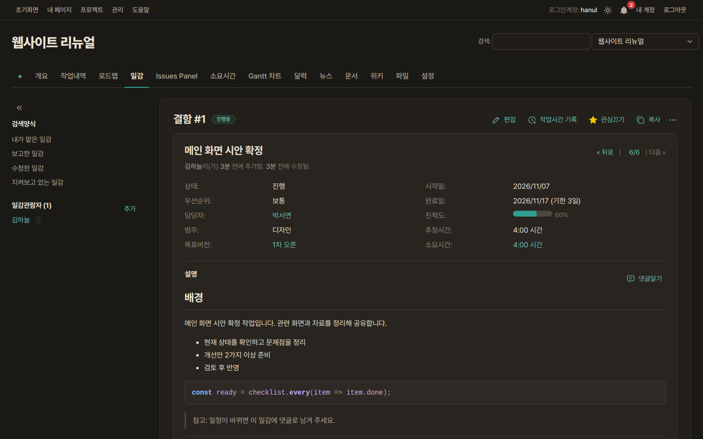
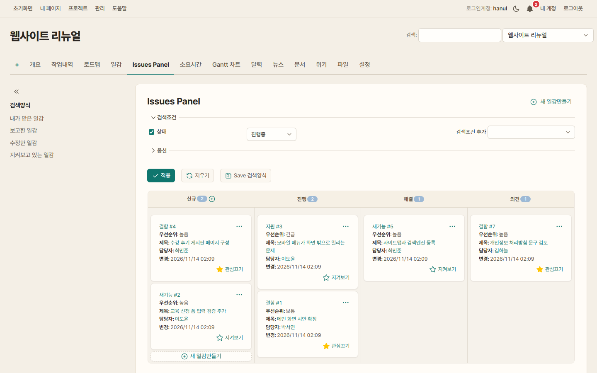
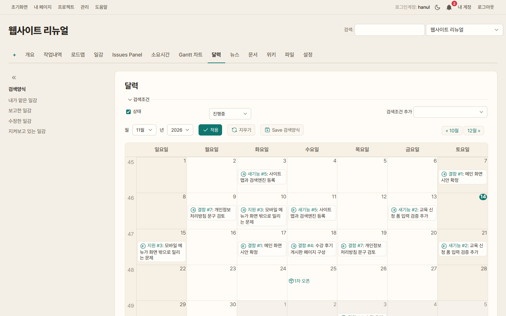
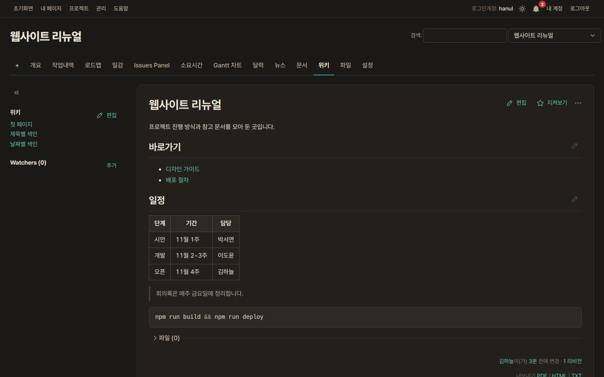
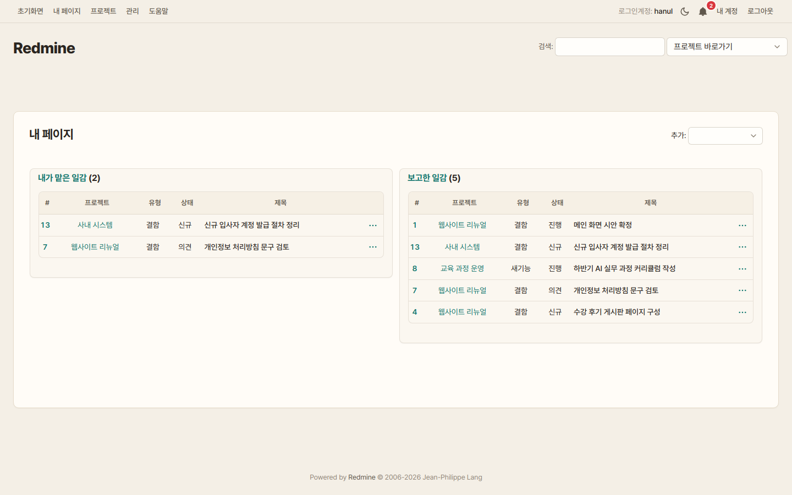
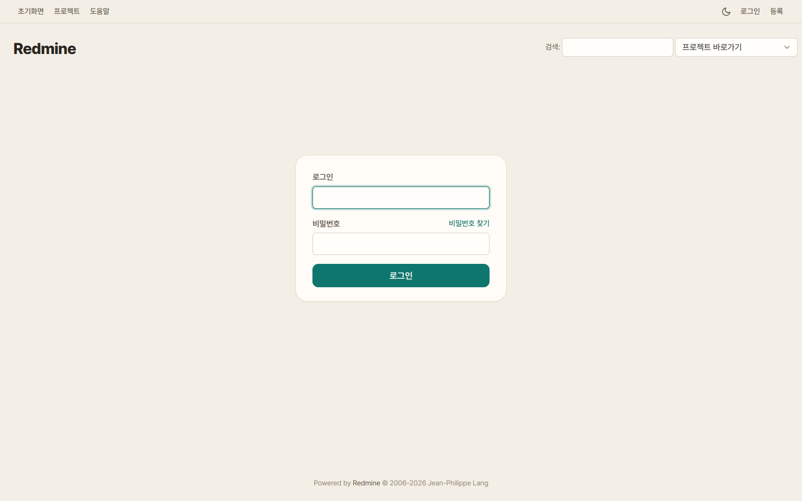
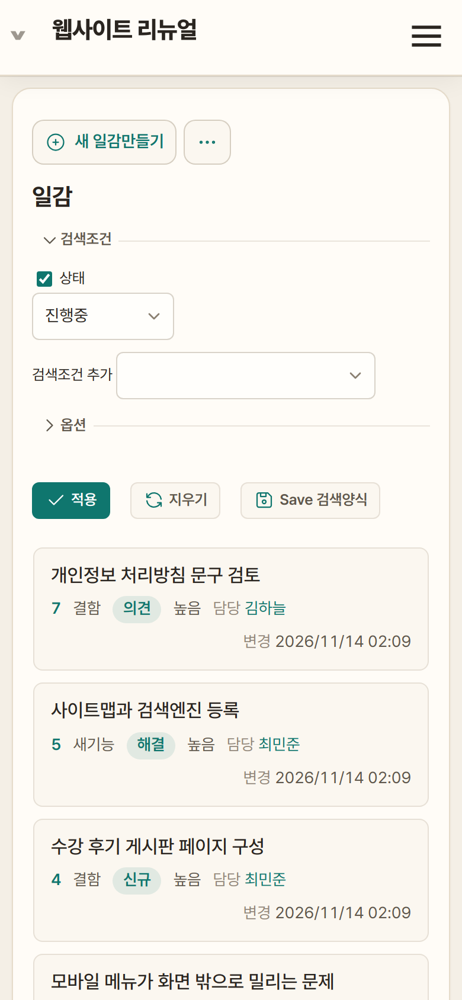
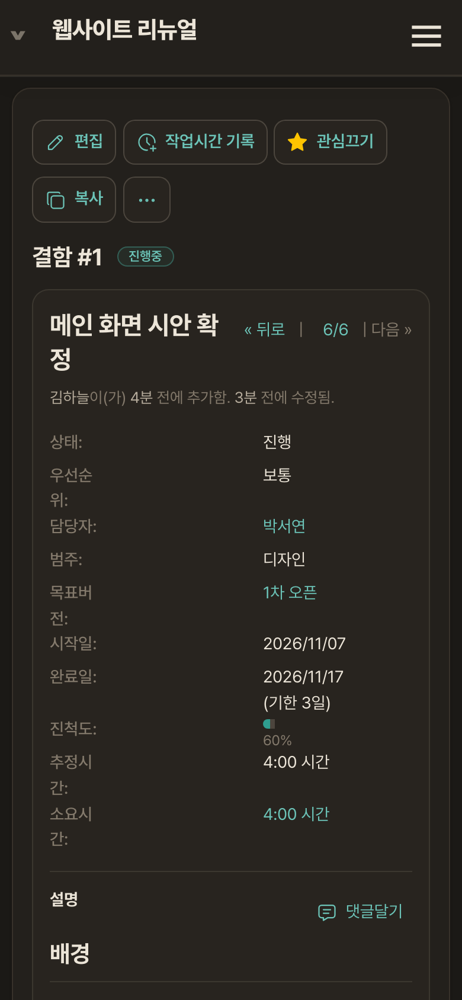
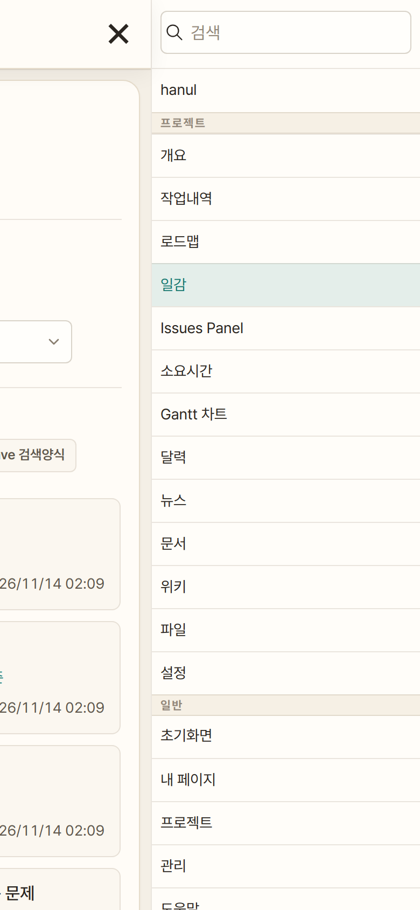

# Hanji Redmine Theme

**English** | [한국어](README.ko.md)

A theme for [Redmine](https://www.redmine.org/) 6, named after hanji, traditional Korean paper.
It uses an ivory page, warm white cards with thin beige lines, ink-colored text and one deep teal accent.
There are no gradients, transparency or other decoration; the goal is comfortable reading. It has light and dark modes.

## Screenshots

**Issue list — light mode**



| **Issue — dark mode** | **Kanban (Issues Panel)** |
|---|---|
|  |  |
| **Calendar** | **Wiki — dark mode** |
|  |  |
| **My page** | **Sign in** |
|  |  |
| **Phone — issue list, issue, menu** | |
|    | |

The screenshots use a Korean interface. The projects, names and issues in them are fictional.

## Features

- **A page of paper.** One content card sits on an ivory page, and the sidebar sits on the left without a frame.
- **Underlined tabs.** The project menu is a single row of tabs; only the selected one gets a teal underline.
- **One accent color.** Primary buttons, selection, progress bars and links all use one teal (`#0F766E`).
- **Light and dark.** The theme follows the operating system at first. The sun/moon button at the top right switches it, and the choice is saved in the browser. Dark mode is a warm charcoal.
- **Phones.** The issue list turns into cards and form fields get bigger. Inputs use 16px text, so iPhones don't zoom in on them.
- **Plugins.** Issues Panel (kanban), Checklists (redmineup) and the web notifications bell follow the theme colors.
- **Lightweight.** No external fonts or images. It is one stylesheet and one short script that adds the sun/moon button. Printed pages come out on a white background.

## Install

From your Redmine directory, clone the theme as `themes/hanji`:

```bash
cd /path/to/redmine
git clone https://github.com/IrumAcademy/Redmine-Hanji-Theme.git themes/hanji
```

1. Restart Redmine. Redmine 6 rebuilds theme assets at startup.
2. In **Administration → Settings → Display → Theme**, pick **Hanji** and save.

To update, run `git -C themes/hanji pull` and restart Redmine.

### Docker (official `redmine` image)

```yaml
services:
  redmine:
    image: redmine:6.0
    volumes:
      - ./themes/hanji:/usr/src/redmine/themes/hanji:ro
```

Recreate the container with `docker compose up -d`, then pick the theme as above.
After you change theme files, restart with `docker compose restart redmine` to apply them.

## Changing the colors

Edit the two token blocks at the top of `stylesheets/application.css`. `:root` is light mode and `html.hanji-dark` is dark mode.

| Token | Used for |
|---|---|
| `--hj-accent`, `--hj-accent-hover` | Primary buttons, selected tab underline, progress bars |
| `--hj-accent-text` | Links and icons |
| `--hj-accent-soft`, `--hj-accent-softer`, `--hj-accent-ring` | Selection backgrounds, row hover, input focus ring |
| `--hj-bg`, `--hj-card`, `--hj-card-border` | Page, content card, card border |

## Compatibility

- Checked on Redmine 6.0.11: issue list, issue view and new issue, kanban, calendar, Gantt, roadmap, wiki, projects, My page, admin settings and sign-in. Each was checked on desktop and phone (390px) in light and dark mode.
- Current Chrome, Edge, Safari and Firefox.
- On phones, the "assignee" and "updated" labels on issue cards only appear in the Korean interface.
- Pages from other plugins may still show some default colors. Please open an issue if you find one.

## License

[MIT](LICENSE) © 2026 IrumAcademy
